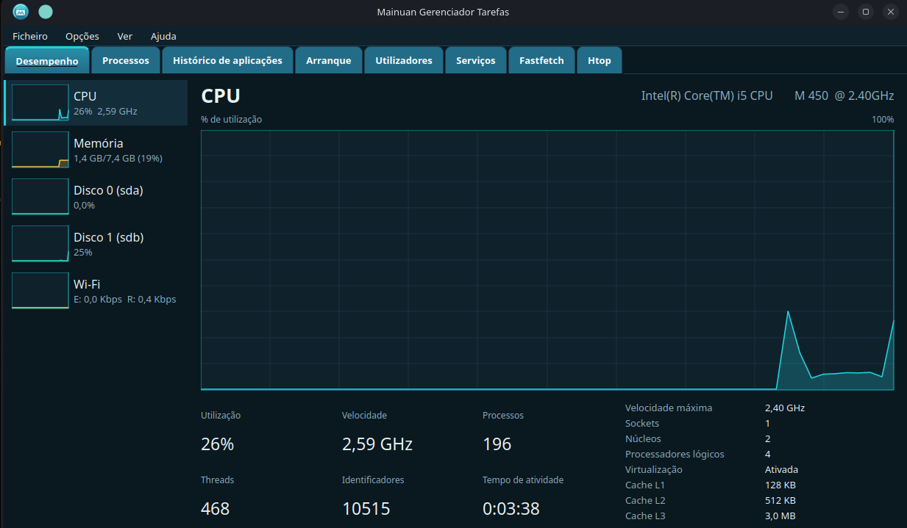
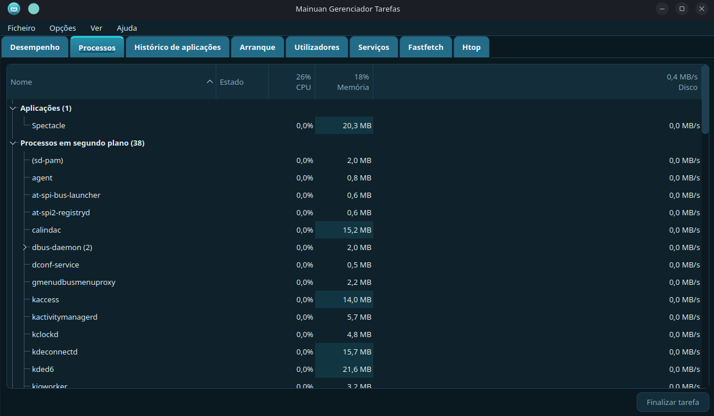
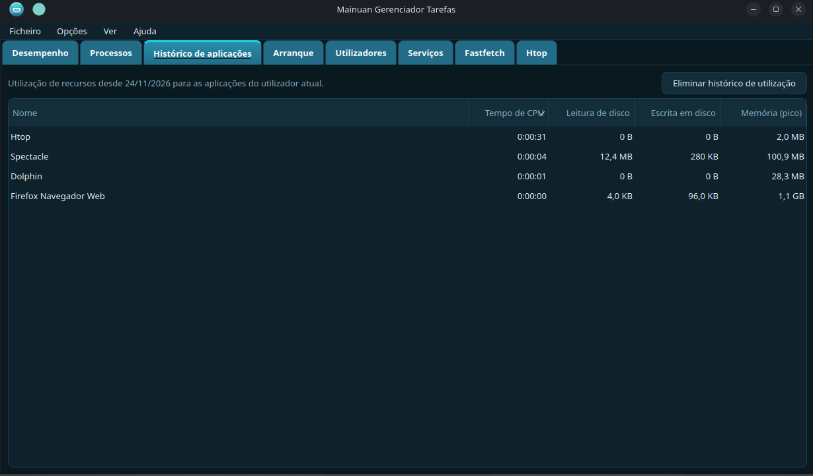
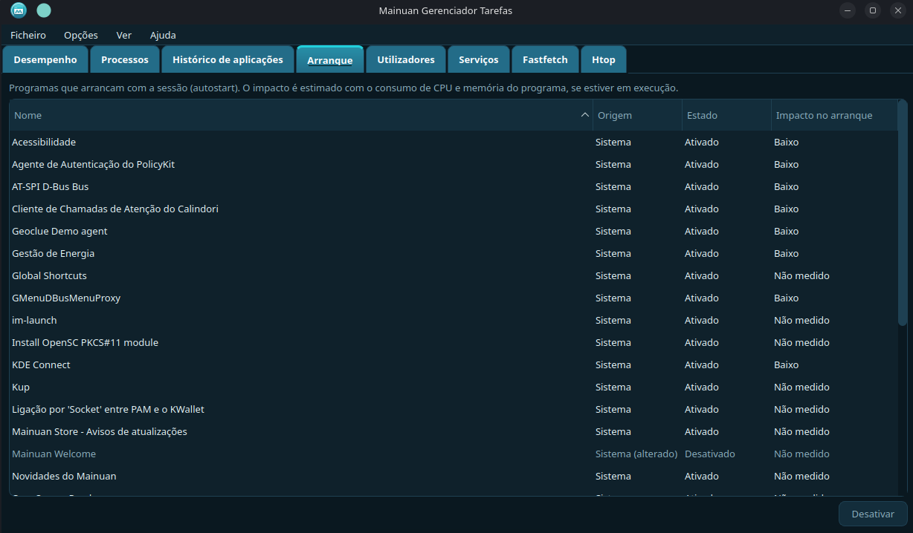

<div align="center">


# Mainuan Gerenciador Tarefas


Monitor de sistema e gestor de tarefas para Linux, inspirado no Gestor de Tarefas do Windows 10. Mostra processos, desempenho (CPU, memória, discos, rede e GPU), histórico de aplicações, arranque, utilizadores e serviços, e inclui separadores com o resultado visual do **Fastfetch** e o **Htop** interativo.



## Funcionalidades

- **Desempenho**: gráficos em tempo real de CPU, memória, discos, rede (Wi-Fi/Ethernet) e GPU, com detalhes como velocidade, processos, threads, cache e virtualização.
- **Processos**: lista agrupada por aplicações e processos em segundo plano, com consumo de CPU, memória e disco. Permite finalizar tarefa, finalizar árvore de processos, forçar encerramento (SIGKILL), definir prioridade e afinidade e abrir o local do ficheiro.
- **Histórico de aplicações**: utilização acumulada de CPU, leitura/escrita em disco e pico de memória por aplicação.
- **Arranque**: programas que arrancam com a sessão (autostart), com estado e impacto estimado, e possibilidade de ativar/desativar.
- **Utilizadores**: utilizadores com sessões e recursos em uso.
- **Serviços**: serviços do systemd, com iniciar, parar e reiniciar.
- **Fastfetch**: informação do sistema com cores, dentro da aplicação.
- **Htop**: Htop interativo integrado num separador.
- Velocidade de atualização configurável (menu *Ver*).
- Idioma detetado automaticamente a partir do sistema: **pt-PT**, **pt-BR**, **inglês**, **espanhol** e **francês**.

## Screenshots

| Processos | Histórico de aplicações |
|---|---|
|  |  |

| Arranque |
|---|
|  |

## Instalação

Pacote `.deb` para sistemas baseados em Debian/Ubuntu (arquitetura `all`).

1. Descarregue o ficheiro `.deb` mais recente na página de [Releases](../../releases/latest).
2. Instale-o:

```bash
sudo apt install ./mainuan-gerenciador-tarefas_1.0.3_all.deb
```

Depois de instalado, procure por **Mainuan Gerenciador Tarefas** no menu de aplicações, ou execute no terminal:

```bash
mainuan-gerenciador-tarefas
```

### Verificar a integridade (opcional)

Na página da release existe um ficheiro `SHA256SUMS`. Para verificar:

```bash
sha256sum -c SHA256SUMS
```

### Desinstalar

```bash
sudo apt remove mainuan-gerenciador-tarefas
```

## Requisitos

| Dependência | Notas |
|---|---|
| `python3` (>= 3.10) | |
| `python3-pyside6.*` ou `python3-pyqt5` | Interface gráfica (Qt) |
| `python3-psutil` | |
| `pkexec` / `policykit-1` | Ações que precisam de privilégios (finalizar processos de outros utilizadores, gerir serviços) |
| `htop`, `util-linux`, `procps` | |
| `fastfetch`, `systemd`, `fonts-dejavu-core` | Recomendados |

O `apt` resolve as dependências automaticamente ao instalar com `sudo apt install ./ficheiro.deb`.

### Nota sobre o Htop e o Fastfetch

Se o `htop` ou o `fastfetch` não estiverem instalados, o pacote tenta instalá-los em segundo plano após a instalação (o registo fica em `/var/log/mainuan-gerenciador-tarefas-install.log`). O `fastfetch` não existe nos repositórios do Ubuntu 22.04/24.04, por isso, em Ubuntu, o script adiciona o PPA `ppa:zhangsongcui3371/fastfetch`. Se não quiser que isto aconteça, instale antes essas ferramentas manualmente, ou defina a variável `MAINUAN_SKIP_TOOLS=1` ao instalar:

```bash
sudo MAINUAN_SKIP_TOOLS=1 apt install ./mainuan-gerenciador-tarefas_1.0.3_all.deb
```

## Segurança

As ações privilegiadas passam por um *helper* executado com `pkexec` (PolicyKit), que pede autenticação ao utilizador. Os argumentos são validados e nada é passado a uma shell.

## Contribuir

Sugestões, relatos de erros e pedidos de melhoria são bem-vindos na secção [Issues](../../issues). Ao reportar um erro, indique a sua distribuição, a versão do pacote e o ambiente de trabalho.

## Autor

**David Caixinha** — tugatechlaDC

## 🤝 Contribuição

Para reportar erros ou pedir funcionalidades, abre um [Issue](https://github.com/mainuan/mainuan-gerenciador/issues). Para propor alterações, envia um pull request para o ramo `main` e regista qualquer alteração visível no [CHANGELOG.md](CHANGELOG.md).


## Licença

Este programa é software livre: pode redistribuí-lo e/ou modificá-lo nos termos da Licença Pública Geral GNU, versão 3 ou posterior. Consulte o ficheiro [LICENSE](LICENSE).
